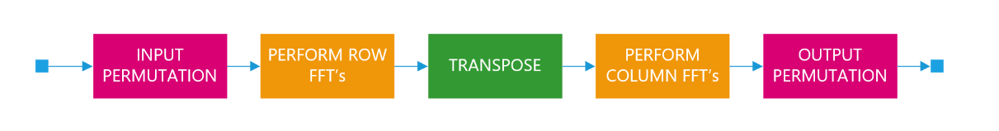
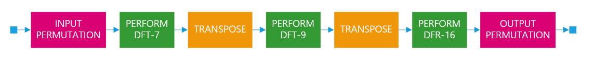
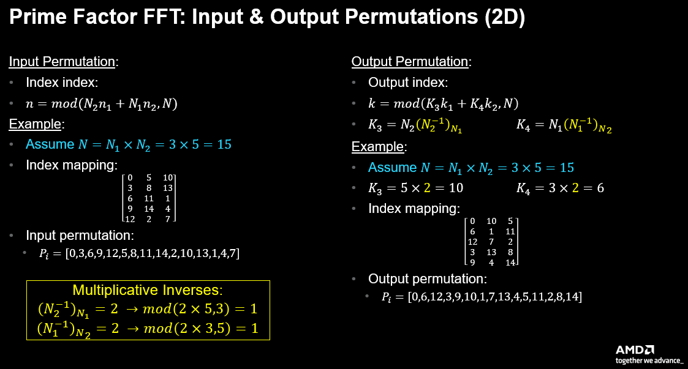
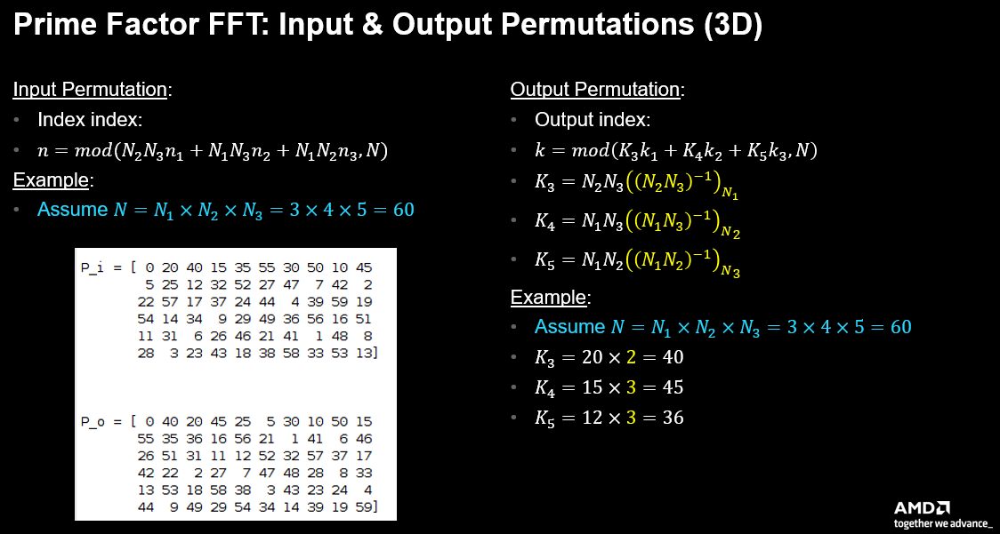
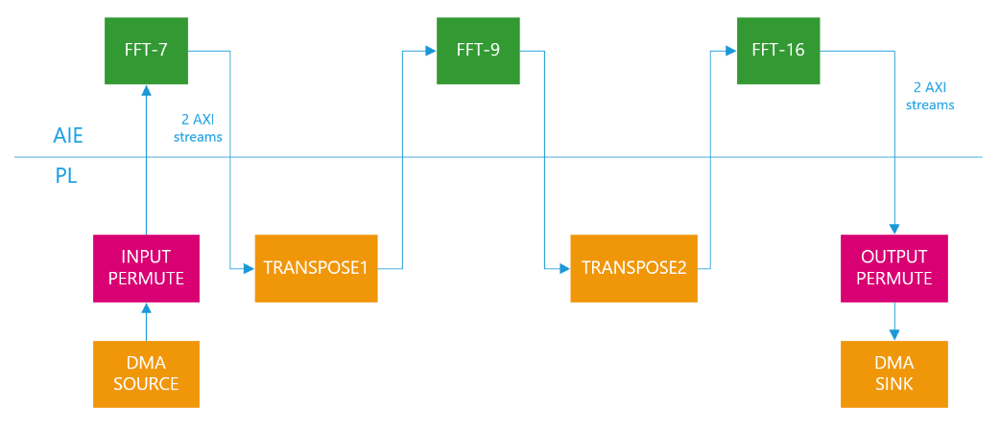
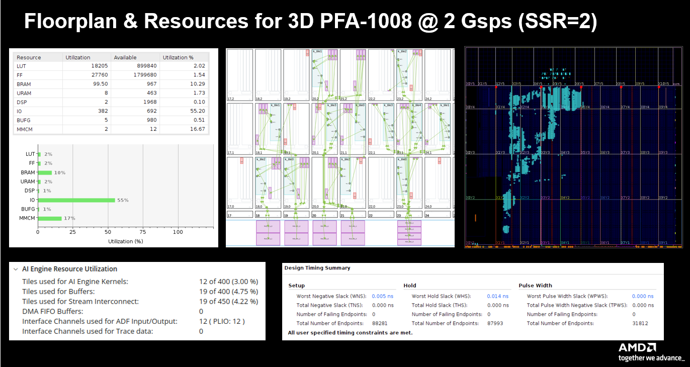

<table class="sphinxhide" style="width:100%;">
  <tr>
    <td align="center">
      <picture>
        <source media="(prefers-color-scheme: dark)" srcset="https://raw.githubusercontent.com/Xilinx/Image-Collateral/main/logo-white-text.png">
        
      </picture>
      <h1>AMD Vitis™ AI Engine Tutorials</h1>
      <a href="https://www.amd.com/en/products/software/adaptive-socs-and-fpgas/vitis.html">See Vitis™ Development Environment on amd.com</a>
        </br>
      <a href="https://www.amd.com/en/products/software/vitis-ai.html">See Vitis™ AI Development Environment on amd.com</a>
    </td>
  </tr>
</table>

# Prime Factor FFT-700

***Version: Vitis 2025.2***

## Table of Contents

1. [Introduction](#introduction)
2. [Matlab Models](#matlab-models)
3. [Design Overview](#design-overview)
4. [Design Resources](#design-resources)
5. [Build and Run Design](#build-and-run-design)

[References](#references)

[Support](#support)

[License](#license)

## Introduction

The Prime Factor Algorithm (PFA) [[1]] is a Fast Fourier Transform (FFT) algorithm [[2]] discovered by Good and Thomas before the more popular Cooley-Tukey algorithm with some interesting properties. The PFA is another "divide and conquer" approach for computing a Discrete Fourier Transform (DFT) of size $N = N_1 \cdot N_2$ as a two-dimensional DFT of size $N_1 \times N_2$ as long as $N_1$ and $N_2$ are relatively prime (that is, share no common divisors). The smaller transforms of size $N_1$ and $N_2$ can be computed by some other technique, for example using the Winograd FFT Algorithm, or the PFA technique can be applied recursively again to both $N_1$ and $N_2$. It turns out AMD Versal™ AI Engines compute DFT with small dimensions $N < 32$ very efficiently using direct vector/matrix multiplication. Consequently, the PFA approach using DFT on the individual prime factors provides an efficient approach to the FFT on Versal AI Engines.

A second advantage of the PFA approach is that unlike the popular Cooley-Tukey FFT, no extra multiplications by "twiddle factors" need be performed between stages. This fact falls out of the DFT factorization when $N_1$ and $N_2$ share no common factors. This provides a computational advantage compared to the more traditional Cooley-Tukey formulation, but the PFA incurs a drawback in that a complicated re-indexing or permutation of it's I/O samples is required. For Versal devices with both AI Engines and Programmable Logic (PL), however, this drawback is solved easily by leveraging the PL to implement these permutations as part of a custom data flow tailored to the PFA signal flow graph.

This tutorial illustrates these concepts by designing a PFA-700 transform in Versal using both AI Engine and PL elements working cooperatively. The PFA approach can apply here since $700 = 7 \times 25 \times 4$. This illustrates a PFA implementation in three dimensions. The transforms for each of these three relatively prime factors are implemented on AI Engine using vector-matrix DFT's. RTL implementations for the I/O permutations and intermediate "memory transpose" operations are obtained using Vitis High Level Synthesis (HLS) from untimed C++ models.

Unlike $1008 = 7 \times 9 \times 16$, none of the pairwise products of 700's factors ($4{\times}25{=}100$, $4{\times}7{=}28$, $25{\times}7{=}175$) are divisible by 8, so the design below cannot reuse the 8-samples/cycle (SSR=8) data movement that a $1008$-point PFA affords. Instead every AIE and PL kernel here moves 2 samples/cycle (SSR=2, one sample per cycle on each of 2 streams), trading throughput (roughly 625 Msps instead of ~2 Gsps) for a much simpler, directly verifiable design.

## MATLAB Models

The following figure shows a block diagram of a 2D PFA transform. It's corresponding MATLAB® model is shown immediately in the following figure. The algorithm consists of the following five steps:

* An input permutation is applied to the input data. The specific input permutation depends on the values of the relative prime factors $N_1$ and $N_2$ as outlined in the following figure.
* The data is organized into an $N_2 \times N_1$ matrix and 1D FFT's are performed along the rows of that matrix.
* A "matrix transpose" operation converts the data flow from "row-wise" to "column-wise" ordering for the subsequent column-based transforms. This amounts to delivering the data using a "strided" addressing pattern.
* A second set of 1D FFT's are performed along the columns of the original matrix.
* An output permutation is applied to the output data after being read column-wise out of its 2D matrix form. The specific output permutation depends on the values of $N_1$ and $N_2$ as outlined in the following figure.

The following MATLAB code shows all of these five steps clearly. The routine `compute_perm_2d()` computes the input permutation `P_i` and output permutation `P_o` applied based on the values of $N_1$ and $N_2$.



```cpp
function [sig_o] = fft_pfa_2d( sig_i, N1, N2 )
    [P_i,P_o,N] = compute_perm_2d(N1,N2);
    % Input permutation
    data = reshape(sig_i(1+P_i),N2,N1);
    % Row transform
    for rr = 1 : N2
      data(rr,:) = fft(data(rr,:));
    end
    % Col transform
    for cc = 1 : N1
      data(:,cc) = fft(data(:,cc));
    end
    % Output permutation
    data_o = reshape(data,1,[]);
    sig_o(1+P_o) = data_o;
end
```

The following figure shows a block diagram of a 3D PFA transform. It's corresponding MATLAB model is shown immediately in the following figure. The algorithm consists of the same steps similar to the 2D case above with the following differences:

* The I/O permutations now depend on three relatively prime factors $N_1$, $N_2$ and $N_3$. The mathematics specific to these 2D and 3D permutations is given in detail in the following figure.
* The data is now organized in a $N_1 \times N_2 \times N_3$ cube instead of an $N_1 \times N_2$ rectangle. Transforms are taken in 1D along each of these dimensions in order, first along $N_1$, then along $N_2$ and finally along $N_3$.
* The "matrix transpose" operations required to extract data in the $N_2$ and $N_3$ dimensions involve slightly more complicated "stride" patterns. These patterns are computed by the MATLAB routine `compute_addr_3d.m`.



```cpp
function [sig_o] = fft_pfa_3d( sig_i, N1, N2, N3 )
    [P_i,P_o,N] = compute_perm_3d(N1,N2,N3);
    % Input permutation:
    data = reshape(sig_i(1+P_i),N1,N2,N3);
    % Transforms
    for cc = 1 : N2
      for dd = 1 : N3
        data(:,cc,dd) = fft(data(:,cc,dd));
      end
    end
    for rr = 1 : N1
      for dd = 1 : N3
        data(rr,:,dd) = fft(data(rr,:,dd));
      end
    end
    for rr = 1 : N1
      for cc = 1 : N2
        data(rr,cc,:) = fft(data(rr,cc,:));
      end
    end
    % Output permutation:
    data_o = reshape(data,1,[]);
    sig_o(1+P_o) = data_o;
end
```

The full suite of MATLAB models illustrating the operation of the PFA transforms is given in the `matlab` folder of the repo.

### I/O Permutations (2D Case)

The following figure illustrates how to compute the I/O permutations required for a 2D PFA solution. The input permutation relies on a simple modulo computation with the relatively prime factors $N_1$ and $N_2$. The figure gives a specific sample with $N_1=3% and $N_2=5$. The input index mapping can be written in a 2D matrix form, or as a 1D address permutation $P_i$.

The output permutation mapping relies on a similar modulo computation but with factors $K_3$ and $K_4$ computed from $N_1$ and $N_2$ and their "multiplicative modulo inverses". Such an inverse $\{(a^{-1}\})_N\equiv I$ is defined such that $mod\{(a\times I,N\})=1$. Using this to solve for $\{(N_2^{-1}\})\_{N_1}$ and $\{(N_1^{-1}\})\_{N_2}$ yields the solution of $K_3=10$ and $K_4=6$ shown in the figure. Once again, the output index mapping can be written in a 2D matrix form, or as a 1D address permutation $P_o$.



### I/O Permutations (3D Case)

The I/O permutations for a 3D PFA solution are solved in a manner similar to the 2D case as shown in the following figure. Essentially, the modulo computations are extended to include a third dimension, and three modulo-inverses are required to solve for the output permutation. These permutations can be expressed in a 3D matrix form, or as a 1D address permutation $P_i$ or $P_o$. The 1D formulation is preferred as it matches how the design is implemented in hardware.



## Design Overview

The figure below shows a block diagram of the original 3D PFA-1008 hardware design implemented in Versal using AI Engines and PL; the PFA-700 design described here follows the same overall dataflow topology (DMA source → input permute → DFT → transpose → DFT → transpose → DFT → output permute → DMA sink), but the per-kernel labels, sample counts and throughput shown in the image are from the earlier 1008-point design and have not been re-rendered.



AI Engines implement the three DFT kernels — DFT-7, DFT-25 and DFT-4 — using a vector-matrix multiplication approach. The design implements the I/O permutation and matrix transpose kernels using Vitis HLS targeting PL. Unlike the 1008-point design, none of 700's factor pairings (4×25=100, 4×7=28, 25×7=175) are divisible by 8, so every kernel here moves exactly 2 samples/cycle (SSR=2: 1 sample/cycle on each of 2 streams) instead of 8. This drops the achievable throughput from the original's ~2 GSPS target to roughly 625 Msps at the same 312.5 MHz clock, but lets every kernel use a much simpler architecture: a full NFFT=700-sample frame is buffered (ping-pong across 2 banks) and read back out through a precomputed address lookup table, rather than the original's hand-tuned cross-lane shuffle/FSM logic needed to realign 8-wide samples to 7/9/16-point transform boundaries.

Some details on each kernel design is given in the sections below.

### INPUT PERMUTE Kernel

This PL kernel is implemented in HLS @ 312.5 MHz (SSR=2). Samples arrive in simple round-robin order (one each cycle on 2 streams) from the DMA source and are written into a ping/pong buffer (2 banks of 700 samples, one sample/cycle/stream). The input permutation $P_i$ is stored as a pair of precomputed per-stream address tables (one entry per cycle, 350 entries each) so the previous frame's buffer can be read back out in the permuted order expected by DFT-7, in simple sequential (FIFO) order on each output stream. The latency of the design is one full 350-cycle frame due to the ping/pong nature of the design.

### FFT-7 Kernel

This AI Engine kernel implements the DFT-7 as a direct 7×7 matrix multiply (coefficients from `matlab/wfta.m`'s `wfta7` case) using a single compute tile — no combiner tile is needed at SSR=2. The two input streams each carry an independent sequential run of 7-pt transforms (100 per frame, split evenly across the 2 streams); each transform is read 1 sample/cycle and its 7 outputs are produced the same way.

### TRANSPOSE1 Kernel

This PL kernel implements in PL the matrix transpose operation required to feed the proper 25-point input samples to the DFT-25 on the second dimension of the 3D cube. The design uses HLS @ 312.5 MHz (SSR=2) with the same ping-pong-buffer-plus-address-LUT architecture as the INPUT PERMUTE kernel, using a transpose address table derived from `compute_addr_3d(N1,N2,N3,2)`. The design has a latency of one full 350-cycle frame.

### FFT-25 Kernel

This AI Engine kernel implements the DFT-25 as a direct 25×25 matrix multiply (coefficients from `matlab/wfta.m`'s `wfta25` case). Since $25=5^2$ is not a product of coprime factors, it cannot be built by nesting two coprime Winograd transforms the way DFT-9 was in the 1008-point design; a direct matrix multiply is used instead, matching the same "vector-matrix DFT" style already used throughout this tutorial. Like FFT-7, this uses a single compute tile with no combiner, with the two streams each carrying an independent sequential run of 25-pt transforms (28 per frame).

### TRANSPOSE2 Kernel

This PL kernel implements in PL the matrix transpose operation required to feed the proper 4-point input samples to the DFT-4 on the third dimension of the 3D cube, using a transpose address table derived from `compute_addr_3d(N1,N2,N3,3)`. The design uses HLS @ 312.5 MHz (SSR=2) with the same ping-pong-buffer-plus-address-LUT architecture as TRANSPOSE1. The design has a latency of one full 350-cycle frame.

### FFT-4 Kernel

This AI Engine kernel implements the DFT-4 as a plain radix-4 butterfly (only ±1/±j factors are needed for a 4-point DFT, so no coefficient table or multiplies are required at all). NFFT (=N1×N2=175, the product of the other two PFA-700 factors) is odd, so — unlike FFT-7 and FFT-25 — the 2 streams cannot each carry independent whole transforms; instead a single transform is split across both streams each cycle (ss0 carries the even-indexed samples x0,x2; ss1 carries the odd-indexed samples x1,x3), the same convention the original 1008-point design used for its power-of-2 kernel (DFT-16).

### OUTPUT PERMUTE Kernel

This PL kernel is implemented in HLS @ 312.5 MHz (SSR=2), using the same ping-pong-buffer-plus-address-LUT architecture as the other permute/transpose kernels, with the output permutation $P_o$ (inverted, since the buffer is indexed by DFT-4's output order) stored as a pair of per-stream address tables. The design has a latency of one full 350-cycle frame. The two output streams format the data in simple round-robin order for consumption by the DMA sink buffer.

## Design Resources

The original 1008-point design's AI Engine/PL resource utilization figure is specific to that design's hand-tuned multi-tile kernels (12 AIE compute tiles, 19 buffer tiles, ~100 PL BRAMs) and has not been re-measured for this PFA-700 redesign — doing so would require a full hardware build, which is out of scope for this change. The PFA-700 design described above uses substantially fewer AIE tiles (one compute tile per DFT kernel, no combiner tiles) at the cost of the lower SSR=2 throughput described above.



## Build and Run Design

### Setup & Initialization

IMPORTANT: Before beginning the tutorial ensure you have installed Vitis™ 2025.2 software. Ensure you have downloaded the Common Images for Embedded Vitis Platforms from [this link](https://www.xilinx.com/support/download/index.html/content/xilinx/en/downloadNav/embedded-platforms.html).

Set the environment variable ```COMMON_IMAGE_VERSAL``` to the full path where you have downloaded the Common Images. Then set the environment variable ```PLATFORM_REPO_PATHS``` to the value ```$XILINX_VITIS/base_platforms```. Additional information on this process can be found [here](../../../AIE#environment-settings).

The remaining environment variables are configured in the top level Makefile ```<path-to-design>/05-Prime-Factor-FFT/Makefile``` file.

```
RELEASE=2025.2

TOP_DIR                   ?= $(shell readlink -f .)
PLATFORM_NAME              = xilinx_vck190_base_202520_1
PLATFORM_PATH              = ${PLATFORM_REPO_PATHS}

export PLATFORM            = ${PLATFORM_PATH}/${PLATFORM_NAME}/${PLATFORM_NAME}.xpfm
export SYSROOT             = ${COMMON_IMAGE_VERSAL}/sysroots/cortexa72-cortexa53-amd-linux
export KERNEL_IMAGE        = ${COMMON_IMAGE_VERSAL}/Image
export ROOTFS              = ${COMMON_IMAGE_VERSAL}/rootfs.ext4
export PREBUILT_LINUX_PATH = ${COMMON_IMAGE_VERSAL}
```

### Hardware Emulation

```sh
[shell]% cd <path-to-design>/05-Prime-Factor-FFT
[shell]% make all TARGET=hw_emu
```

This takes about 90 minutes to run. The build process generates a folder ```05-Prime-Factor-FFT/package``` containing all the files required for hardware emulation. This can be run as shown below. An optional `-g` can be applied to the ```launch_hw_emu.sh``` command to launch the Vivado waveform GUI to observe the top-level AXI signal ports in the design.

```sh
[shell]% cd <path-to-design>/05-Prime-Factor-FFT/package
[shell]% ./launch_hw_emu.sh -run-app embedded_exec.sh
```

### Hardware

You can build this design for the VCK190 board using the Makefile as follows:

```sh
[shell]% cd <path-to-design>/05-Prime-Factor-FFT
[shell]% make all TARGET=hw
```

The build process generates the SD card image in the ```<path-to-design>/05-Prime-Factor-FFT/package/sd_card``` folder.

## References

[1]: <https://en.wikipedia.org/wiki/Prime-factor_FFT_algorithm> "Prime Factor FFT Algorithm"

[[1]] Wikipedia, "[Prime Factor FFT Algorithm](https://en.wikipedia.org/wiki/Prime-factor_FFT_algorithm)"

[2]: <https://eng.libretexts.org/Bookshelves/Electrical_Engineering/Signal_Processing_and_Modeling/Fast_Fourier_Transforms_(Burrus)> "Fast Fourier Transforms"

[[2]] C. Sidney Burrus, "[Fast Fourier Transforms](https://eng.libretexts.org/Bookshelves/Electrical_Engineering/Signal_Processing_and_Modeling/Fast_Fourier_Transforms_(Burrus))"

## Support

Requests and bugs are tracked using GitHub issues. For questions, go to [support.xilinx.com](http://support.xilinx.com/).

<p class="sphinxhide" align="center"><sub>Copyright © 2023-2025 Advanced Micro Devices, Inc</sub></p>
<p class="sphinxhide" align="center"><sup><a href="https://www.amd.com/en/corporate/copyright">Terms and Conditions</a></sup></p>
